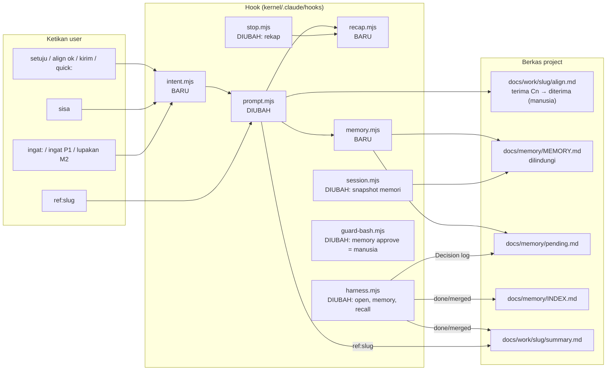
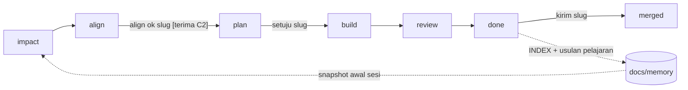
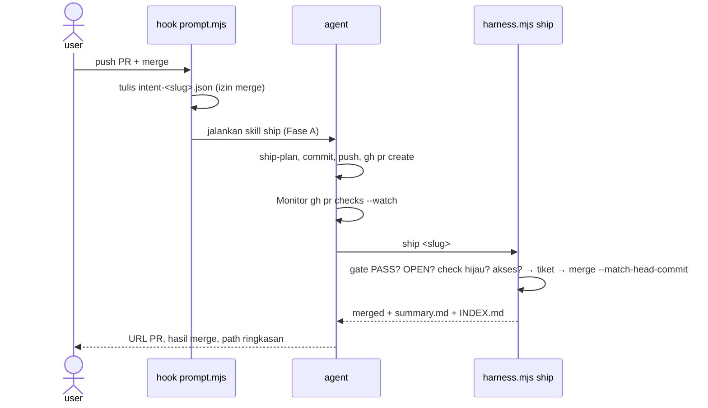

# Roadmap: 1.10.0 → 1.21 → 2.0.0

> **Status per 2026-11-20 (harness 1.21.1)**
> - **Selesai:** semua rilis 1.10–1.13 di bawah dan rancangan "Sederhana" 1.14–1.21 (§9).
> - **Belum mulai:** 2.0.0. Gerbang pilot belum lewat (§10).
> - **Arah 2.0 (2026-11-21): Plane dicabut** (D37, menggantikan D36 = B). Semua dikendalikan mesin lokal masing-masing; fokus 2.0 = **orkestrator** (§12). Keputusan user ditampilkan sebagai blok mencolok (D38); hasil persona ditulis ke berkas item (D39).
> - Riwayat: D36 = B (2026-11-20) sempat memilih berkas lokal + Plane cermin. Sejak 1.16 berkas lokal justru diperkuat (`plan.md` tunggal, `docs/topics/`, jawaban dicatat hook ke berkas), jadi T1–T10 versi lama (§8) tidak lagi sinkron dengan harness.

Tujuan: **mudah dipakai, tidak mondar-mandir, dan makin pintar seiring umur project**, tanpa melepas gerbang yang membuat harness aman (approve, merge, dan memori tetap keputusan manusia).

## 1. Masalah yang dipecahkan

| # | keluhan | akar | jawaban 1.10.0 |
|---|---|---|---|
| K1 | `/harness:xxx` terlalu kaku | tiap langkah butuh hafalan nama skill + slug lengkap | intent tanpa slash: `setuju <slug>`, `align ok <slug>`, `kirim <slug>`, `sisa`, slug boleh potongan |
| K2 | align buntu: "2 klaim masih bertentangan" | hook hanya menolak, tanpa isi klaim dan tanpa jalan keluar selain mengedit file | tabel klaim di pesan + `align ok <slug> terima C2` (risiko diterima, tercatat) |
| K3 | diskusi work item terlalu panjang, "ngawang" | keluaran naratif | rule: diskusi = tabel keputusan (maks 4 baris); skill align membalas tabel |
| K4 | lupa apa yang belum selesai | status tersebar di banyak file | tabel **Belum selesai** (`sisa`, `harness.mjs open`, otomatis di Stop) |
| K5 | hasil kerja lama sulit dirujuk | summary ada per item, tapi tidak terindeks | `docs/memory/INDEX.md`, `recall <kata>`, `ref:<slug>` |
| K6 | tidak makin pintar seiring waktu | pengetahuan hanya di knowledge per service | memori project berbatas + usulan pelajaran dari Decision log |

## 2. Riset

### antislop (`miqdadbadjuber/anti-slop`)
Dibaca dari `skills/antislop/SKILL.md` dan README. Jumlah star tidak bisa saya pastikan (API GitHub repo itu tidak terjangkau dari sesi ini); README menampilkan lencana Trendshift harian/bulanan.

| mekanisme | detail | kenapa menarik |
|---|---|---|
| masalah yang terlihat | before/after gambar UI, copy, kode | nilai terbukti dalam 3 detik, tanpa membaca |
| aturan bernomor bertingkat | R-01..R-40: Hard Gate / Purpose-Gate / Quality Locks | bisa dirujuk ("langgar R-17"), bisa diaudit |
| Delivery Gate | laporan PASS/FAIL wajib sebelum kirim | hasil bisa diperiksa, bukan klaim |
| skill per concern | 6 skill (ui, copy, human, layout, code) | agent hanya memuat yang perlu → konteks kecil |
| dua mode | during / after; preferensi disimpan sekali | user tidak ditanya berulang |
| distribusi tanpa gesekan | `npx antislop-ai`, skills.sh, plugin 7 agent | satu perintah, lintas agent |
| "filter, bukan style guide" | tidak memaksakan arah; arah dari `DESIGN.md` | posisinya jelas, tidak bertabrakan dengan selera user |

### Hermes Agent (`NousResearch/hermes-agent`, "the agent that grows with you")
Dibaca dari README dan `website/docs/.../memory.md`, `skills.md` di GitHub (situs docs-nya diblokir jaringan sesi ini).

| mekanisme | detail |
|---|---|
| memori berbatas | `MEMORY.md` 2.200 karakter + `USER.md` 1.375; entri dipisah `§`; disuntik sebagai snapshot beku di awal sesi (menjaga prefix cache) |
| penuh = galat | tidak memadatkan diam-diam; agent merapikan sendiri |
| `write_approval` | opsional: tulisan memori/skill diantrekan, manusia menyetujui (`/memory pending`) |
| review latar (learning loop) | setelah giliran, fork meninjau dan menyimpan koreksi berulang sebagai memori atau skill prosedural |
| skill dari pengalaman | `skill_manage` membuat/menambal skill setelah alur multi-langkah, galat yang berhasil diatasi, atau koreksi user |
| progressive disclosure | daftar skill (nama+deskripsi) dulu, isi penuh saat perlu |
| session search | SQLite FTS5 atas semua sesi, tanpa LLM |
| user model | Honcho (dialektik) lintas sesi |

### ATM (Amati → Tiru → Modifikasi)

| amati | tiru | modifikasi untuk harness | rilis |
|---|---|---|---|
| Hermes: memori berbatas + snapshot | `docs/memory/MEMORY.md`, batas karakter, disuntik SessionStart | disimpan di repo (bisa di-review di PR), bukan di home; penuh = ditolak | 1.10.0 |
| Hermes: agent menulis memori sendiri | `memory add/forget` oleh agent | bawaan seperti Hermes; `write_approval: true` = antrean `pending.md` | 1.10.0 |
| Hermes: session search | `recall <kata>` | grep berperingkat atas summary/brief/align/sesi; nol token | 1.10.0 |
| Hermes: learning loop | usulan pelajaran saat `done` | deterministik dari `## Decision log` (tanpa model, tanpa fork) | 1.10.0 |
| antislop: aturan ringkas, keluaran terperiksa | tabel keputusan, tabel Belum selesai | dihasilkan kode, bukan ditulis bebas oleh model | 1.10.0 |
| antislop: mode tersimpan | flag di `harness.config.json` | per project | 1.10.0 |
| Hermes: skill dari pengalaman | playbook `docs/memory/playbooks/<nama>.md` | ditulis agent langsung (D4); awal sesi hanya nama + deskripsi; lint menolak yang rusak/terlalu besar | 1.11.0 ✔ |
| antislop: aturan bernomor | ID rule (`O-`, `S-`, `W-`, `K-`, `M-`, `P-`) di `.claude/rules/*` | kolom `aturan` di review; `check-repo` menolak ID ganda | 1.11.0 ✔ |
| Hermes: user model | profil user | per orang di `~/.harness/USER.md`, bukan di repo (root dipakai tim) | 1.11.0 ✔ |
| antislop: before/after | tabel sebelum/sesudah di README | teks, bukan gambar | 1.11.0 ✔ |

## 3. Perubahan artefak

Alur kerja tidak berubah urutannya; yang berubah adalah **cara masuk** (kalimat pendek) dan **cara keluar** (tabel, bukan narasi):

## 4. Feature flag (`harness.config.json`)

| flag | bawaan | efek | matikan bila |
|---|---|---|---|
| `intent.enabled` | `true` | kalimat pendek → perintah | tim lebih suka slash murni |
| `intent.max_chars` | `120` | prompt lebih panjang selalu dianggap chat | ada false positive |
| `align.accept_contradictions` | `true` | `align ok <slug> terima C2` | ingin klaim bertentangan wajib dikoreksi |
| `recap.enabled` | `true` | `open` / `sisa` | — |
| `recap.on_stop` | `true` | tabel Belum selesai di akhir giliran (hanya bila berubah) | terasa berisik |
| `recap.max_rows` | `12` | batas baris tabel | — |
| `memory.enabled` | `true` | memori project, snapshot di awal sesi | tidak ingin konteks tambahan |
| `memory.max_chars` | `2200` | batas MEMORY.md | — |
| `memory.write_approval` | `false` | gaya Hermes: agent menulis sendiri | (`true`) ingin menyetujui tiap tulisan agent |
| `ship.merge_on_request` | `true` | ketikan ship = PR + merge saat hijau + ringkasan | (`false`) merge butuh ketikan kedua setelah hijau |
| `ship.intent_ttl_min` | `240` | umur izin merge tertunda | — |
| `memory.learn_from_summary` | `true` | usulan pelajaran dari Decision log saat `done` | — |
| `memory.learn_max` | `3` | maks usulan per item | — |
| `memory.ref_max_chars` | `3000` | batas ringkasan yang disuntik `ref:` | — |

## 5. Versi

| versi | isi | alasan nomor |
|---|---|---|
| **1.10.0** (rilis ini) | intent, align terima, Belum selesai, memori, recall/ref | aditif, semua di belakang flag, tidak ada yang rusak → **minor** |
| 1.11.0 (rilis) | profil user per orang, playbook (skill dari pengalaman), ID rule, before/after | aditif |
| 1.12.0 (rilis) | tabel keputusan dibuat kode + ditahan Stop, plan setelah aligned, langkah berikutnya dari kode, versi plugin di doctor | aditif; menutup T2/T3 |
| 1.13.0 (rilis) | jembatan: Plane berisi kartu + checklist + diskusi (cermin lokal), `plane migrate` dry-run/apply/verify, log pilot + `bukan itu`, slash usang, `migrate` + doctor "siap 2.0", slug ringkas | aditif; folder lokal belum dihapus |
| 1.14–1.21 (rilis) | rancangan "Sederhana" + pilot: status line, plan tunggal, pemilih, spesialis, pengetahuan tumbuh, antislop, sandbox, satu sesi satu item, topik, persona (§9) | aditif |
| 2.0.0 | **satu pintu**: work item, diskusi, knowledge di Plane; lokal hanya cermin; folder `docs/work/*` dihapus per root setelah `migrate --verify` COCOK; slash tinggal `init`/`update`; format align lama dibuang. Hanya bila `pilot` S1–S4 OK | ada yang **dibuang** → major |

## 6. Target malam ini (1.10.0)

- [x] intent tanpa slash (`intent.mjs`, `prompt.mjs`)
- [x] align: pesan tabel + `terima Cn`
- [x] tabel Belum selesai: CLI `open`, ketikan `sisa`, rekap di Stop
- [x] memori project: `ingat`, antrean, batas, snapshot, proteksi
- [x] INDEX + usulan pelajaran saat done/merged, `recall`, `ref:<slug>`
- [x] rule output + skill align/next + AGENTS.md
- [x] tes `test/v1100.test.mjs` (9) + suite lama (180) hijau; `check-repo` 12/12
- [x] ~~uji `systemMessage` dari hook Stop~~ digantikan: rekap ditampilkan agent sebagai tabel Markdown (`recap.render: assistant`, 1.13.1); diuji di Claude Code asli selama pilot
- [ ] pilot di satu root (yhpa), lalu `harness-update.mjs --all`: update-all berjalan; pilot yhpa sampai merged masih terbuka (lihat §10)

## 7. Keputusan

| # | pertanyaan | keputusan | implementasi |
|---|---|---|---|
| D1+D2 | "push summary ke staging" / "sampai staging" | **"push PR + merge" = satu keputusan**: PR → merge saat hijau → ringkasan | izin merge tertunda dari hook (`ship.merge_on_request`); ringkasan di root `main` (`summary.md`, `INDEX.md`) |
| D3 | `kirim <slug>` sebelum ada PR | langsung buat PR | skill `ship` boleh dipanggil model, hanya atas konteks hook |
| D4 | pelajaran tanpa persetujuan | **gaya Hermes** | `memory.write_approval: false` bawaan |
| D5 | model profil user (`USER.md`) | 1.11.0: per orang di `~/.harness/USER.md` | `ingat user: ...` + agent `memory add --user` (gaya Hermes, mengikuti D4) |

Alur ship sesudah D1–D3:

## 8. Menuju 2.0.0: satu pintu (keputusan D6–D19) — rencana awal, ditinjau ulang di §11

Objective: **work item, diskusi, dan knowledge tinggal di Plane; lokal hanya cermin untuk hook; user cukup membuka Plane dan menjawab @mention.**

| # | keputusan | jawaban |
|---|---|---|
| D6 | rilis jembatan dulu | ya: 1.13 mengukur + memperingatkan, 2.0 membuang |
| D7 | flag yang dikunci | bawaan dikunci, flag tetap ada sebagai escape hatch |
| D8 | slash yang tampil di 2.0 | hanya `init` dan `update` |
| D9 | ambang pilot | 0 salah tangkap + ≥1 "push PR + merge" sampai merged; jendela **6 jam** (diubah user dari 14 hari; `pilot.hours`), lalu user menyimpulkan naik ke 2.0 atau tidak |
| D10 | align format lama | migrasi otomatis |
| D14 | checklist AC | to-do list di deskripsi kartu |
| D15 | "agent di cloud" | sesi Claude (cloud/lokal) yang berkomentar di kartu |
| D16 | project yhpa | project baru **YHPA** di Plane (dibuat 2026-11-10) |
| D17 | knowledge | Plane Pages sebagai sumber, cermin lokal untuk hook |
| D18 | kapan folder dihapus | di 2.0, per root, setelah baca-balik cocok |
| D19 | kapan @mention | hanya saat keputusan menahan pekerjaan |
| D20 | deskripsi yang diedit di Plane | tidak ditimpa: `push` DITAHAN bila deskripsi di Plane berubah sejak kiriman terakhir (centang checklist tidak dihitung); agent diberi tahu lewat inbox; `push --force` setelah diselaraskan |
| D21 | approve di 2.0 | tetap dari ketikan user ("setuju EVENT-15"); kolom Plane hanya tampilan. Alasan: agent memakai API key user, jadi Plane tidak bisa membedakan siapa yang memindahkan kartu |
| D22 | penamaan item di 2.0 | nomor kartu Plane (`EVENT-15`) jadi rujukan; slug lokal hilang |
| D23 | urutan | D20 diperbaiki → PR 1.13 → merge → pilot 6 jam → 2.0 |

Ukuran (`harness.mjs pilot`, jendela 6 jam): S1 frasa ≥ slash · S2 salah tangkap ≤ 0 · S3 tabel keputusan ditahan Stop ≥ 1 · S4 "push PR + merge" sampai merged ≥ 1. Per root: `harness.mjs migrate` semua OK.

Bentuk kartu: judul · deskripsi (Tujuan, Konteks, Keputusan) · checklist AC · komentar (diskusi, progres, link PR, summary penutup). Lokal menarik komentar di awal sesi, tiap prompt (maks 1×/menit), atau saat user mengetik `tarik`; webhook ke laptop tidak mungkin, jadi tidak real-time.

Task 2.0:

| # | task | isi |
|---|---|---|
| T1 | model data tanpa folder | AC, keputusan D, status dibaca dari kartu lewat cermin terstruktur `.harness/plane/<id>.json` |
| T2 | hook membaca cermin | `gate`, Stop, `sisa`, `decide`, `next` |
| T3 | jawaban keputusan lewat komentar | "D2: a", "C3 benar" di kartu → keputusan terjawab |
| T4 | item baru langsung di Plane | `quick:` / impact membuat kartu dulu; rujukan `EVENT-15` (D22) |
| T5 | knowledge → Plane Pages + cermin | verifikasi endpoint Pages di REST API dulu |
| T6 | `plane migrate --delete` per root | hanya setelah `--verify` COCOK; `INDEX.md` berisi URL kartu |
| T7 | antrean offline | `plane-outbox`, dikirim ulang |
| T8 | perampingan | skill selain `init`/`update` internal; template lama dibuang; rule/AGENTS.md ditulis ulang |
| T9 | panduan upgrade 1.13 → 2.0 | langkah per root + rollback |
| T10 | gerbang rilis | `pilot` S1–S4 OK + `migrate` OK di event/astra/yhpa |

> **Catatan untuk setelah 2.0.0 selesai (permintaan user, 2026-11-10):** work item yang sudah ada di event, astra, dan yhpa **diarsipkan** di Plane. User akan meminta agent di sesi cloud menghubungkan Plane lewat MCP (workspace `hardiyanto`: EVENT `39039364-1222-4a52-97c1-de1314305bed`, ASTRA `d8b0e13e-87ef-4ada-b405-7dd4a7bd8cdf`, YHPA `6c13b388-718a-4f06-b1bc-a0d57bc10f15`) untuk memeriksa dan mengarsipkan kartu (`workitem archive`; hanya kartu Done/Cancelled yang bisa diarsipkan). Folder lokal dihapus per root lewat T6, bukan lewat MCP.

## 9. Yang sudah rilis sesudah 1.13 (rancangan "Sederhana", `docs/v1.15/`)

| versi | isi | pilar PRD |
|---|---|---|
| 1.14.0 | advisor Opus opt-in; reviewer tanpa worktree | — |
| 1.15.x | status line, nama sesi `/summarize`, output style, saran tanpa `/harness:`, "kerjakan", uji M0 (`spike.mjs`) | A1, E |
| 1.16.0 | **satu berkas per item** (`plan.md` empat bagian), pemilih keputusan (`ask.mjs`), menu | B, A2, A3 |
| 1.17.0 | spesialis per bidang (`backend`/`frontend`/`devops`/`dba`), `bidang.enforce` (mati) | C |
| 1.18.0 | rujukan otomatis, pelajaran lewat pemilih, playbook per bidang, `growth` | D |
| 1.19.0 | antislop sebagai salinan aturan (MIT) | F |
| 1.19.1–1.19.6 | perbaikan dari pilot dan **sandbox** (`scripts/sandbox.mjs`, gh tiruan): klaim di pemilih, jawaban ketik dicatat hook, ship tidak macet di commit, align ok tanpa klaim | — |
| 1.20.0 | **satu sesi = satu work item**; Stop lebih jarang menahan | — |
| 1.21.0 | **topik** (`docs/topics/`) untuk diskusi/analisa/audit sebelum item ("jadikan item"); **persona** rekan engineer (`rules/persona.md`); batas 5 baris dihapus | — |
| 1.21.1 | ID persona `R-` → `G-` (bentrok dengan ID antislop `R-xx` yang dikutip reviewer) | — |

Ukuran PRD §6 yang **belum diukur** di project nyata: ketikan perintah per item ≤ 3, keputusan lewat pemilih ≥ 80%, eksekusi oleh spesialis benar ≥ 90%. Sumbernya log pilot dan audit (`agent` di audit sejak 1.19.2).

## 10. Gerbang pilot (syarat T10)

| syarat | status | bukti / yang kurang |
|---|---|---|
| S1 frasa ≥ slash | ✅ | sandbox: 5 frasa vs 0 slash |
| S2 salah tangkap ≤ 0 | ✅ | sandbox: 0 |
| S3 tabel keputusan ditahan Stop ≥ 1 | ✅ | sandbox: 1 penahanan |
| S4 "push PR + merge" sampai merged ≥ 1 | ✅ | sandbox 1.22.5 (uji T12): PR `…/sandbox/backend/pull/1` merged pada percobaan pertama; seri uji sandbox T1–T20, N1–N9, E1–E5 selesai di 1.22.7 |
| GitHub asli | ❌ | satu item kecil di **event** sampai PR merged (keputusan user 2026-11-21: dicoba bersama patch kecil di project itu) |
| M0-1 jawaban pemilih tercatat | ✅ | `(pemilih)` di plan.md sandbox |
| M0-2b audit mencatat agent | ✅ | `"agent":"backend"` di audit sandbox |
| `migrate` OK per root (event/astra/yhpa) | ❓ | hanya wajib untuk arah A (§11) |
| `bidang.enforce` | ⏸ | boleh dinyalakan sekarang (M0-2b terbukti); keputusan user |

## 11. Arah 2.0 ditinjau ulang (D36: **B**, 2026-11-20) — **digantikan D37** (§12)

**Pertanyaan:** apakah Plane tetap menjadi **sumber kebenaran** (rencana §8), atau **berkas lokal tetap sumber** dan Plane menjadi tampilan + pintu diskusi?

| | Arah A: Plane sumber (rencana awal) | Arah B: lokal sumber, Plane cermin + diskusi |
|---|---|---|
| Sumber kebenaran | kartu Plane; lokal hanya cermin `.harness/plane/<id>.json` | `docs/work/<slug>/plan.md` dan `docs/topics/`; Plane menerima push + komentar |
| Gerbang hook | membaca cermin; bergantung pada tarikan terakhir | membaca berkas langsung (seperti sekarang) |
| Offline / API Plane turun | butuh antrean (T7); gerbang bisa membaca data usang | tetap jalan; Plane menyusul |
| Approve | tetap dari ketikan (D21, kartu tidak bisa membedakan manusia) | sama |
| Riwayat di git | hilang dari repo (folder dihapus T6) | tetap di repo, bisa di-review di PR |
| Fitur 1.16–1.21 | perlu dipetakan ulang ke kartu (plan tunggal, topik, jawaban yang dicatat hook) | tidak berubah |
| Ukuran kerja | besar: T1–T10 + pemetaan baru | kecil: perampingan + Plane dua arah terbatas |
| Yang dibuang (alasan major) | folder `docs/work/*`, format lama | bentuk folder lama, slash selain `init`/`update`, format align lama |

**Rekomendasi: Arah B (GAS DENGAN CATATAN).**
- **Alasan:** gerbang yang membuat harness aman membaca berkas secara langsung dan deterministik; seluruh kerja 1.16–1.21 dibangun di atas berkas; pilot belum membuktikan Plane sebagai sumber.
- **Catatan:** user yang ingin "cukup membuka Plane" tetap terlayani lewat komentar dua arah dan @mention (T3, D19), tetapi kartu bukan tempat AC dan klaim diedit.

### Task 2.0 bila Arah B dipilih

| # | task | isi | asal |
|---|---|---|---|
| B1 | perampingan alur | skill selain `init`/`update` internal; slash lain dibuang; rule dan `AGENTS.md` ditulis ulang ≤ 60 baris | T8, D8 |
| B2 | bentuk lama dibuang | `item.bentuk: folder` dan format `align.md` lama: migrasi otomatis item terbuka ke `plan.md` tunggal, item merged dibiarkan | D10 |
| B3 | jawaban lewat komentar Plane | "D2: a", "C3 benar" di kartu → dicatat hook ke `plan.md` (parser 1.19.4 dipakai ulang) | T3 |
| B4 | topik di Plane (opsional) | topik terbuka dikirim sebagai kartu berlabel "topik"; "jadikan item" juga bisa dari komentar | baru |
| B5 | antrean offline | `plane-outbox` untuk push/komentar yang gagal | T7 |
| B6 | panduan upgrade 1.21 → 2.0 | langkah per root + rollback | T9 |
| B7 | gerbang rilis | §10 hijau (S1–S4 + GitHub asli) di yhpa, event, astra | T10 |

### Task 2.0 bila Arah A dipilih

T1–T10 di §8 tetap berlaku, ditambah:
- **A11:** petakan `plan.md` tunggal (bagian 1–4, klaim, baris D, Bukti, Tinjauan) ke deskripsi kartu, checklist, dan komentar.
- **A12:** topik → kartu Plane; "jadikan item" dari kartu.
- **A13:** hook pemilih/jawaban ketik menulis ke kartu lewat cermin, dengan konflik dari D20.

### Urutan
1. Tutup §10 (S4 + GitHub asli).
2. ~~User menjawab D36~~ → **B**. Task 2.0 = B1–B7; cakupan orkestrator Plane menyusul dari user (§12).
3. Rilis 2.0 dipecah per task, satu PR per rilis, seperti 1.19–1.21.

## 12. 2.0 = orkestrator lokal, tanpa Plane (D37–D39, 2026-11-21)

### Keputusan

| # | keputusan | alasan / isi |
|---|---|---|
| D37 | **Plane dicabut.** Semua dikendalikan mesin lokal masing-masing | feedback user; menggantikan D36 dan seluruh task Plane (T1–T7, B3–B5, A11–A13) |
| D38 | **Blok "butuh keputusan"**: setiap keputusan atau persetujuan yang menahan eksekusi didahului `> ## ⚠ BUTUH KEPUTUSANMU` + path berkas + "tolong dibaca ulang sebelum kita eksekusi" | TUI tidak bisa memperbesar huruf; heading dalam blockquote = penekanan terkuat. Rilis 1.22.0 (tabel keputusan + rekap + persona G-18) |
| D39 | **Hasil persona masuk berkas work item/topik**; chat hanya ringkasan + path | keputusan dan alasan terlacak di berkas, bukan hilang di chat. Rilis 1.22.0 (persona G-17, O-09) |

### Orkestrator: definisi

| bagian | isi |
|---|---|
| orkestrator | **sesi chat utama** yang dibuka user. Tidak mengedit kode service sendiri |
| saat "kerjakan" | memecah AC jadi tugas per service/bidang: siapa, urutan, mana yang paralel; rencana ditulis ke `plan.md` (`### Rencana eksekusi`) dan ditampilkan dengan blok D38 sebelum mulai |
| sub-agent | spesialis `backend` / `frontend` / `devops` / `dba`, lalu `runner` (test) dan `reviewer`; masing-masing melapor |
| sesudahnya | orkestrator mengumpulkan laporan, memeriksa bukti per AC, meneruskan ke review |
| batasan Claude Code | sub-agent tidak bisa memanggil sub-agent lain → orkestrasi selalu satu tingkat dari sesi utama |
| sudah ada | 1.17: "kerjakan" memanggil spesialis per service; audit mencatat `agent` (1.19.2) |

### Task 2.0 (menggantikan B1–B7)

| # | task | isi |
|---|---|---|
| R1 | **cabut Plane** | `plane.mjs`, config `plane.*`, tarik komentar di prompt, status line Plane, `migrate`/doctor bagian Plane, `AGENTS.md` bagian Plane, tes Plane; data `.harness/plane/` dibiarkan (bisa dihapus user) |
| O1 | rencana eksekusi tertulis | `### Rencana eksekusi` di `plan.md`: `| # | tugas | AC | agent | urutan/paralel | status |`; dibuat orkestrator saat "kerjakan", diperlihatkan dengan blok D38 |
| O2 | pelacakan per tugas | status tugas diperbarui dari laporan sub-agent (audit `agent_id`); status line: `tugas 2/4` |
| O3 | sesi utama hanya mengorkestrasi | `bidang.enforce` bawaan menyala setelah O1–O2 stabil: edit kode service dari sesi utama ditolak |
| O4 | ukuran | ≥ 90% edit kode oleh spesialis yang benar; ketikan user per item ≤ 3 (PRD §6) |
| R2 | perampingan | slash selain `init`/`update` dibuang; `AGENTS.md` ≤ 60 baris (dulu B1) |
| R3 | bentuk lama dibuang | `item.bentuk: folder` + format `align.md` lama → migrasi item terbuka ke `plan.md` tunggal (dulu B2) |
| R4 | panduan upgrade + rollback | per root (dulu B6) |
| R5 | gerbang rilis | §10 hijau (S1–S4 + GitHub asli) di yhpa, event, astra (dulu B7; `migrate` Plane tidak lagi syarat) |

Urutan: tutup §10 → R1 (cabut Plane) → O1–O4 → R2–R4 → R5 → v2.0.0. Satu PR per rilis.

> Catatan arsip kartu Plane (2026-11-10, §8) tetap boleh dikerjakan manual oleh user lewat MCP; harness tidak lagi menyentuh Plane.
