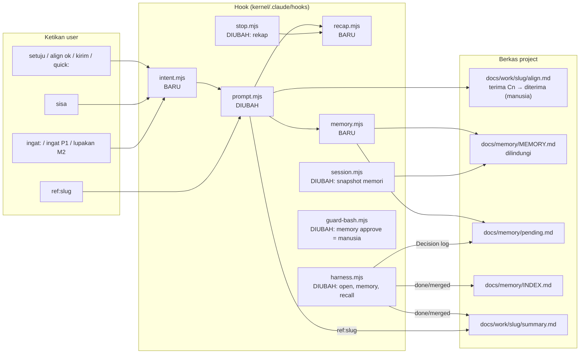
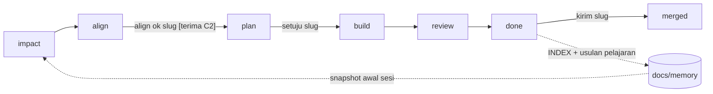
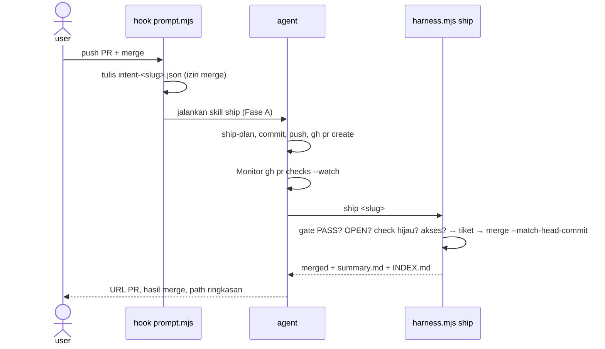

# Roadmap: 1.10.0 → 1.11.0 → 2.0.0

Tujuan: **mudah dipakai, tidak mondar-mandir, dan makin pintar seiring umur project**, tanpa melepas gerbang yang membuat harness aman (approve, merge, dan memori tetap keputusan manusia).

## 1. Masalah yang dipecahkan

| # | keluhan | akar | jawaban 1.10.0 |
|---|---|---|---|
| K1 | `/harness:xxx` terlalu kaku | tiap langkah butuh hafalan nama skill + slug lengkap | intent tanpa slash: `setuju <slug>`, `align ok <slug>`, `kirim <slug>`, `sisa`, slug boleh potongan |
| K2 | align buntu: "2 klaim masih bertentangan" | hook hanya menolak, tanpa isi klaim dan tanpa jalan keluar selain mengedit file | tabel klaim di pesan + `align ok <slug> terima C2` (risiko diterima, tercatat) |
| K3 | diskusi work item terlalu panjang, "ngawang" | keluaran naratif | rule: diskusi = tabel keputusan (maks 4 baris); skill align membalas tabel |
| K4 | lupa apa yang belum selesai | status tersebar di banyak file | tabel **Belum selesai** (`sisa`, `harness.mjs open`, otomatis di Stop) |
| K5 | hasil kerja lama sulit dirujuk | summary ada per item, tapi tidak terindeks | `docs/memory/INDEX.md`, `recall <kata>`, `ref:<slug>` |
| K6 | tidak makin pintar seiring waktu | pengetahuan hanya di knowledge per service | memori project berbatas + usulan pelajaran dari Decision log |

## 2. Riset

### antislop (`miqdadbadjuber/anti-slop`)
Dibaca dari `skills/antislop/SKILL.md` dan README. Jumlah star tidak bisa saya pastikan (API GitHub repo itu tidak terjangkau dari sesi ini); README menampilkan lencana Trendshift harian/bulanan.

| mekanisme | detail | kenapa menarik |
|---|---|---|
| masalah yang terlihat | before/after gambar UI, copy, kode | nilai terbukti dalam 3 detik, tanpa membaca |
| aturan bernomor bertingkat | R-01..R-40: Hard Gate / Purpose-Gate / Quality Locks | bisa dirujuk ("langgar R-17"), bisa diaudit |
| Delivery Gate | laporan PASS/FAIL wajib sebelum kirim | hasil bisa diperiksa, bukan klaim |
| skill per concern | 6 skill (ui, copy, human, layout, code) | agent hanya memuat yang perlu → konteks kecil |
| dua mode | during / after; preferensi disimpan sekali | user tidak ditanya berulang |
| distribusi tanpa gesekan | `npx antislop-ai`, skills.sh, plugin 7 agent | satu perintah, lintas agent |
| "filter, bukan style guide" | tidak memaksakan arah; arah dari `DESIGN.md` | posisinya jelas, tidak bertabrakan dengan selera user |

### Hermes Agent (`NousResearch/hermes-agent`, "the agent that grows with you")
Dibaca dari README dan `website/docs/.../memory.md`, `skills.md` di GitHub (situs docs-nya diblokir jaringan sesi ini).

| mekanisme | detail |
|---|---|
| memori berbatas | `MEMORY.md` 2.200 karakter + `USER.md` 1.375; entri dipisah `§`; disuntik sebagai snapshot beku di awal sesi (menjaga prefix cache) |
| penuh = galat | tidak memadatkan diam-diam; agent merapikan sendiri |
| `write_approval` | opsional: tulisan memori/skill diantrekan, manusia menyetujui (`/memory pending`) |
| review latar (learning loop) | setelah giliran, fork meninjau dan menyimpan koreksi berulang sebagai memori atau skill prosedural |
| skill dari pengalaman | `skill_manage` membuat/menambal skill setelah alur multi-langkah, galat yang berhasil diatasi, atau koreksi user |
| progressive disclosure | daftar skill (nama+deskripsi) dulu, isi penuh saat perlu |
| session search | SQLite FTS5 atas semua sesi, tanpa LLM |
| user model | Honcho (dialektik) lintas sesi |

### ATM (Amati → Tiru → Modifikasi)

| amati | tiru | modifikasi untuk harness | rilis |
|---|---|---|---|
| Hermes: memori berbatas + snapshot | `docs/memory/MEMORY.md`, batas karakter, disuntik SessionStart | disimpan di repo (bisa di-review di PR), bukan di home; penuh = ditolak | 1.10.0 |
| Hermes: agent menulis memori sendiri | `memory add/forget` oleh agent | bawaan seperti Hermes; `write_approval: true` = antrean `pending.md` | 1.10.0 |
| Hermes: session search | `recall <kata>` | grep berperingkat atas summary/brief/align/sesi; nol token | 1.10.0 |
| Hermes: learning loop | usulan pelajaran saat `done` | deterministik dari `## Decision log` (tanpa model, tanpa fork) | 1.10.0 |
| antislop: aturan ringkas, keluaran terperiksa | tabel keputusan, tabel Belum selesai | dihasilkan kode, bukan ditulis bebas oleh model | 1.10.0 |
| antislop: mode tersimpan | flag di `harness.config.json` | per project | 1.10.0 |
| Hermes: skill dari pengalaman | usulan skill/pola project dari item berulang | lewat `patterns-proposal` yang sudah ada + persetujuan manusia | 1.11.0 |
| antislop: aturan bernomor | ID rule (H-01, Q-03) di `.claude/rules/*` + dirujuk di review | 1.11.0 |
| Hermes: user model | `docs/memory/USER.md` (preferensi gaya kerja user) | 1.11.0 |
| antislop: before/after | demo di README | 1.11.0 |

## 3. Perubahan artefak

Alur kerja tidak berubah urutannya; yang berubah adalah **cara masuk** (kalimat pendek) dan **cara keluar** (tabel, bukan narasi):

## 4. Feature flag (`harness.config.json`)

| flag | bawaan | efek | matikan bila |
|---|---|---|---|
| `intent.enabled` | `true` | kalimat pendek → perintah | tim lebih suka slash murni |
| `intent.max_chars` | `120` | prompt lebih panjang selalu dianggap chat | ada false positive |
| `align.accept_contradictions` | `true` | `align ok <slug> terima C2` | ingin klaim bertentangan wajib dikoreksi |
| `recap.enabled` | `true` | `open` / `sisa` | — |
| `recap.on_stop` | `true` | tabel Belum selesai di akhir giliran (hanya bila berubah) | terasa berisik |
| `recap.max_rows` | `12` | batas baris tabel | — |
| `memory.enabled` | `true` | memori project, snapshot di awal sesi | tidak ingin konteks tambahan |
| `memory.max_chars` | `2200` | batas MEMORY.md | — |
| `memory.write_approval` | `false` | gaya Hermes: agent menulis sendiri | (`true`) ingin menyetujui tiap tulisan agent |
| `ship.merge_on_request` | `true` | ketikan ship = PR + merge saat hijau + ringkasan | (`false`) merge butuh ketikan kedua setelah hijau |
| `ship.intent_ttl_min` | `240` | umur izin merge tertunda | — |
| `memory.learn_from_summary` | `true` | usulan pelajaran dari Decision log saat `done` | — |
| `memory.learn_max` | `3` | maks usulan per item | — |
| `memory.ref_max_chars` | `3000` | batas ringkasan yang disuntik `ref:` | — |

## 5. Versi

| versi | isi | alasan nomor |
|---|---|---|
| **1.10.0** (rilis ini) | intent, align terima, Belum selesai, memori, recall/ref | aditif, semua di belakang flag, tidak ada yang rusak → **minor** |
| 1.11.0 | `USER.md`, ID rule, usulan skill/pola otomatis, demo before/after | aditif |
| 2.0.0 | bahasa pendek jadi antarmuka utama (skill `/harness:*` dirampingkan), format align lama dibuang, hanya bila pilot 1.10–1.11 membuktikan tidak ada false positive | ada yang **dibuang** → major (semver) |

## 6. Target malam ini (1.10.0)

- [x] intent tanpa slash (`intent.mjs`, `prompt.mjs`)
- [x] align: pesan tabel + `terima Cn`
- [x] tabel Belum selesai: CLI `open`, ketikan `sisa`, rekap di Stop
- [x] memori project: `ingat`, antrean, batas, snapshot, proteksi
- [x] INDEX + usulan pelajaran saat done/merged, `recall`, `ref:<slug>`
- [x] rule output + skill align/next + AGENTS.md
- [x] tes `test/v1100.test.mjs` (9) + suite lama (180) hijau; `check-repo` 12/12
- [ ] uji di Claude Code asli: `systemMessage` dari hook Stop tampil ke user di versimu (belum terverifikasi di sandbox)
- [ ] pilot di satu root (yhpa), lalu `harness-update.mjs --all`

## 7. Keputusan

| # | pertanyaan | keputusan | implementasi |
|---|---|---|---|
| D1+D2 | "push summary ke staging" / "sampai staging" | **"push PR + merge" = satu keputusan**: PR → merge saat hijau → ringkasan | izin merge tertunda dari hook (`ship.merge_on_request`); ringkasan di root `main` (`summary.md`, `INDEX.md`) |
| D3 | `kirim <slug>` sebelum ada PR | langsung buat PR | skill `ship` boleh dipanggil model, hanya atas konteks hook |
| D4 | pelajaran tanpa persetujuan | **gaya Hermes** | `memory.write_approval: false` bawaan |
| D5 | model profil user (`USER.md`) | terbuka | rekomendasi: 1.11.0, diisi dari `ingat user: ...` |

Alur ship sesudah D1–D3:

